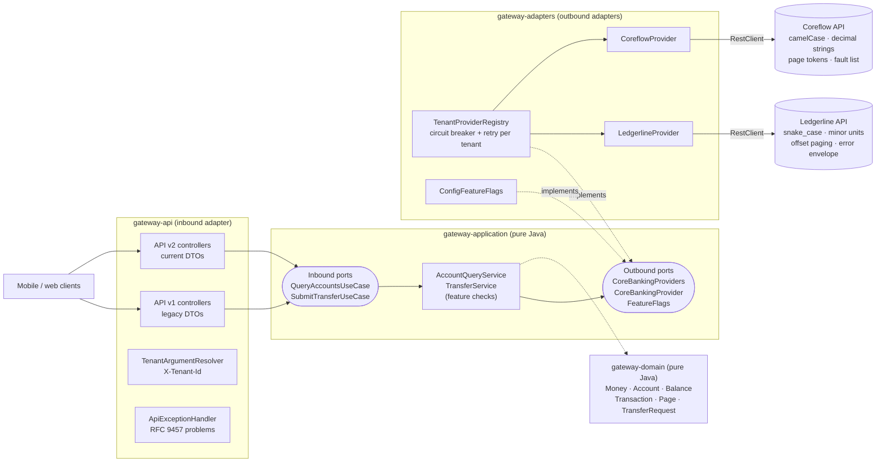
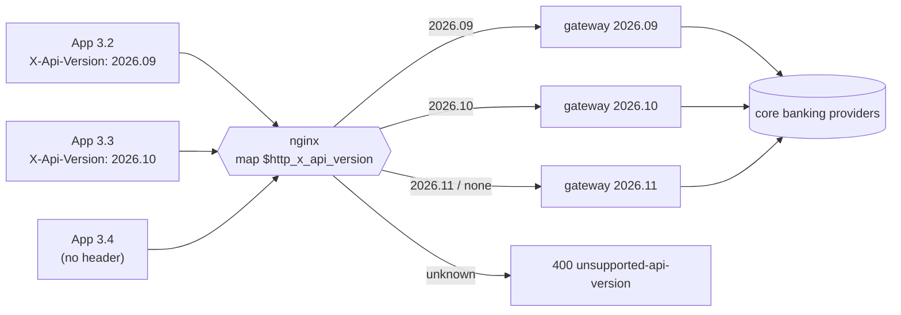

# Core Banking Gateway

[](https://github.com/filipopov/core-banking-gateway/actions/workflows/ci.yml)


[](LICENSE)

**One stable REST API in front of several core banking systems that all speak different dialects.**

Banks rarely run on one core system. Apps still want one API: the same JSON for an account balance whether the bank
behind it returns snake_case minor units with offset paging or camelCase decimal strings with page tokens. This
project is a small, fully tested reference implementation of that gateway:

- **Hexagonal architecture**, with dependency rules enforced by ArchUnit on every build
- **Two provider adapters** for two deliberately different (fictitious) core banking APIs, *Ledgerline* and *Coreflow*
- **Multi-tenancy**: each bank is a tenant in `application.yml` with its own provider, base URL, timeouts and features
- **Per-tenant feature flags**: switch `transfers` or `transaction-search` on or off per bank without a code change
- **Two API versions side by side** (`/api/v1`, `/api/v2`) with documented breaking changes, plus an nginx config for
  routing to several *gateway releases* by request header
- **One error model**: every upstream error format becomes an RFC 9457 `application/problem+json` response
- **Resilience**: connect and read timeouts, plus a resilience4j circuit breaker and retry per tenant
- **Stub-based contract tests**: the same WireMock mappings drive the adapter tests, the integration tests, local
  runs and docker compose

**Author:** Filip Popov · [LinkedIn](https://linkedin.com/in/filipopov)

---

## Contents

- [Architecture](#architecture)
- [Quick start](#quick-start)
- [API examples](#api-examples)
- [Key design decisions](#key-design-decisions)
- [Running several gateway versions side by side](#running-several-gateway-versions-side-by-side)
- [Project structure](#project-structure)
- [Testing](#testing)
- [Limitations and what's next](#limitations-and-whats-next)

## Architecture



Dependencies point inwards. `gateway-domain` and `gateway-application` contain no Spring, Jackson or HTTP code;
`gateway-app` is the composition root that creates the services and plugs in the adapters. `ArchitectureTest`
checks this on every build:

- domain depends only on `java.*`; application only on `java.*` and the domain
- the API layer talks to inbound ports only, never to services, outbound ports or adapters
- adapters never depend on the API layer, and provider adapters never depend on each other
- `api.v1` and `api.v2` never depend on each other
- no field injection, no `System.out`, no `java.util.logging`

## Quick start

Requirements: JDK 21. Maven comes with the wrapper.

```bash
./mvnw -B verify            # build + all tests (no Docker needed)
```

### Run locally with the mock providers (no Docker)

`LocalGatewayApplication` (in the test sources) starts both WireMock mocks in the same JVM, Ledgerline on `8081` and
Coreflow on `8082`, and then the gateway on `8080`:

```bash
./mvnw -B install -DskipTests
./mvnw -pl gateway-app spring-boot:test-run
```

Swagger UI: <http://localhost:8080/swagger-ui.html> (two documents: *API v1 (legacy)* and *API v2 (current)*).

### Run against mocks you start yourself

Start any WireMock 3 server per provider with `mocks/ledgerline` and `mocks/coreflow` as root directories on ports
8081 and 8082, then run the plain application:

```bash
./mvnw -B install -DskipTests
./mvnw -pl gateway-app spring-boot:run
```

### Docker compose

```bash
docker compose up --build
```

This builds the gateway image and runs it with two `wiremock/wiremock:3.13.2` containers serving the same mappings.
The `docker` Spring profile points the tenants at the mock containers.

### Configured tenants

| Tenant | Provider | Currency | Features |
|--------|----------|----------|----------|
| `alpine-bank` | Ledgerline | CHF | `transfers`, `transaction-search` |
| `harbor-bank` | Coreflow | EUR | `transfers` |
| `meadow-bank` | Ledgerline | CHF | none |

`meadow-bank` shares its provider with `alpine-bank`, which makes it easy to see that feature flags belong to the
tenant, not the provider.

## API examples

All examples run against the local setup above. Responses are real output, pretty-printed.

**Same v2 shape, different providers.** Ledgerline returns `booked_minor: 1254075`; Coreflow returns
`{"type": "closingBooked", "amount": {"value": "3120.40"}}`. Clients see neither:

```bash
curl -s -H 'X-Tenant-Id: alpine-bank' localhost:8080/api/v2/accounts/LL-1001/balances
```

```json
{
  "accountId": "LL-1001",
  "booked":    { "amount": "12540.75", "currency": "CHF" },
  "available": { "amount": "12040.75", "currency": "CHF" }
}
```

**Same data, v1 shape.** Amounts are JSON numbers with a sibling `currency` field:

```bash
curl -s -H 'X-Tenant-Id: harbor-bank' localhost:8080/api/v1/accounts/cf-acc-2001/balances
```

```json
{ "accountId": "cf-acc-2001", "bookedAmount": 3120.40, "availableAmount": 2980.40, "currency": "EUR" }
```

**Cursor paging (v2).** Pass `nextCursor` back as `cursor` until it is `null`:

```bash
curl -s -H 'X-Tenant-Id: harbor-bank' 'localhost:8080/api/v2/accounts/cf-acc-2001/transactions?size=2'
```

```json
{
  "items": [
    { "id": "tx-9f3a", "bookingDate": "2026-10-21", "amount": { "amount": "-3.80", "currency": "EUR" },
      "description": "Bakery", "counterpartyName": "Corner Bakery" },
    { "id": "tx-9f39", "bookingDate": "2026-10-19", "amount": { "amount": "2400.00", "currency": "EUR" },
      "description": "Salary", "counterpartyName": "Example Employer GmbH" }
  ],
  "nextCursor": "Y2Y6cHQtMg"
}
```

**Transfer:**

```bash
curl -s -X POST localhost:8080/api/v2/transfers \
  -H 'X-Tenant-Id: alpine-bank' -H 'Content-Type: application/json' \
  -d '{"fromAccountId": "LL-1001", "toAccountId": "LL-1002",
       "amount": {"amount": "25.00", "currency": "CHF"}, "reference": "Savings"}'
```

```json
{ "transferId": "LTR-80001", "status": "BOOKED" }
```

**Feature switched off for a tenant:**

```bash
curl -s -H 'X-Tenant-Id: harbor-bank' 'localhost:8080/api/v2/accounts/cf-acc-2001/transactions?q=bakery'
```

```json
{
  "type": "https://github.com/filipopov/core-banking-gateway/blob/main/docs/problems.md#feature-disabled",
  "title": "Feature not enabled",
  "status": 403,
  "detail": "Feature 'transaction-search' is not enabled for tenant 'harbor-bank'",
  "instance": "/api/v2/accounts/cf-acc-2001/transactions",
  "code": "feature-disabled",
  "tenant": "harbor-bank",
  "feature": "transaction-search"
}
```

**Upstream error, translated:**

```bash
curl -s -H 'X-Tenant-Id: alpine-bank' localhost:8080/api/v2/accounts/LL-4040
```

```json
{
  "type": "https://github.com/filipopov/core-banking-gateway/blob/main/docs/problems.md#account-not-found",
  "title": "Account not found",
  "status": 404,
  "detail": "Account 'LL-4040' was not found",
  "instance": "/api/v2/accounts/LL-4040",
  "code": "account-not-found",
  "accountId": "LL-4040"
}
```

The mocks also contain an insufficient-funds case for both providers: any transfer of 10,000.00 or more.

| Endpoint | v1 | v2 |
|----------|----|----|
| `GET /api/vN/accounts` | yes | yes |
| `GET /api/vN/accounts/{id}` | yes | yes |
| `GET /api/vN/accounts/{id}/balances` | flat numbers | money objects |
| `GET /api/vN/accounts/{id}/transactions` | `?limit=`, plain array | `?cursor=&size=&q=`, envelope |
| `POST /api/vN/transfers` | numeric `amount` + `currency` | money object |

## Key design decisions

### Why hexagonal

The interesting part of a gateway is not the HTTP plumbing but the boundary between "what the bank calls things" and
"what the app needs". Ports and adapters put that boundary in the type system: the domain has one `Money`, one
`Balance`, one `Page`, and every provider-specific detail (field names, minor units, paging style, error format) is
confined to that provider's package. Adding a provider or an API version therefore touches exactly one side of the
hexagon. The modules make the boundary physical, and ArchUnit keeps it from eroding.

### Adding a provider in 7 steps

1. Model the upstream JSON as package-private records (`VaulticApi`).
2. Implement `CoreBankingProvider`, running each call through `UpstreamCalls` and translating error codes.
3. Add a `ProviderFactory` that names the provider.
4. Register the factory as a bean in `GatewayConfiguration`.
5. Add WireMock stubs under `mocks/vaultic/`.
6. Test the adapter against the stubs (mapping, paging, errors, timeout).
7. Point a tenant at it with `provider: vaultic`.

Details: [`docs/adding-a-provider.md`](docs/adding-a-provider.md).

### Versioning strategy

Two separate mechanisms, explained in [`docs/api-versioning.md`](docs/api-versioning.md):

- **Contract versions in the URL.** `/api/v1` and `/api/v2` live in the same deployment as separate controller
  packages with separate DTOs, calling the same use cases. A breaking wire-format change means a new package, not an
  `if (version == 2)`. v2's breaking changes: money as `{amount, currency}` with the amount as a decimal string, and
  cursor-paged transaction envelopes.
- **Release pinning by header.** Several gateway builds run side by side and nginx routes by `X-Api-Version`. See
  [below](#running-several-gateway-versions-side-by-side).

### Feature flags

`FeatureFlags` is an outbound port with one method, `isEnabled(tenant, feature)`. The only implementation,
`ConfigFeatureFlags`, reads `gateway.tenants.<id>.features`. Checks happen in the application services, not in
controllers, so v1 and v2 cannot disagree. A disabled feature yields `403 feature-disabled` *before* the provider is
called. A typo in a feature key fails startup instead of silently disabling the feature. Replacing the config with a
flag service would mean one new adapter class.

### Error model

Clients get exactly one error format: RFC 9457 problem details with a stable `type` URI and `code`, documented in
[`docs/problems.md`](docs/problems.md). Translation happens in three steps:

1. A provider-specific status handler parses the upstream error body (Ledgerline `{"error": {...}}`, Coreflow
   `{"faults": [...]}`) into a neutral `UpstreamError`.
2. The adapter maps known codes to domain exceptions (`AccountNotFoundException`, `InsufficientFundsException`, ...).
3. `UpstreamCalls` maps everything else: I/O errors, timeouts and 5xx become `ProviderUnavailableException` (503,
   retryable); unknown codes and malformed payloads become `ProviderContractException` (502, contract drift).

Upstream messages are logged, never forwarded. A payload that breaks a domain invariant (say, an unknown currency) is
a provider bug and returns 502, not a 400 blaming the client.

### Money handling

`Money` is `BigDecimal` + `java.util.Currency`, normalised to the currency's minor-unit scale (2 for CHF/EUR, 0 for
JPY, 3 for BHD), so equal amounts are also `equals()`. Amounts with more decimals than the currency allows are
rejected rather than rounded. `ofMinor` and `toMinorUnits` convert exactly for providers that use integer minor units.
There is no `double` anywhere in the money path, and v2 serialises amounts as strings so clients cannot accidentally
parse them as floats.

### Resilience

Each tenant gets its own `RestClient` (JDK HTTP client, explicit connect and read timeouts) and its own circuit breaker
and retry, so one failing bank cannot trip the breaker for another. Only `ProviderUnavailableException` counts as a
failure; a 404 neither opens the circuit nor triggers a retry. Reads are retried; transfers are not, because a
retried transfer is a double payment unless the provider supports idempotency keys.

## Running several gateway versions side by side

URL versions solve the contract problem. They don't solve the **regression** problem: every gateway release, even a
refactoring or a bug fix, can break a client app version that is still installed on thousands of phones. With N
supported app versions, every gateway release has to be regression-tested against all N of them.

Release pinning changes that. Each client release sends the gateway release it was built and tested against, and an
edge proxy routes to exactly that build:



- Deployed releases are immutable images. App 3.2 keeps talking to the exact code it was tested against.
- A new gateway release only has to be tested with the app release that will pin it. The test matrix shrinks from
  *apps x gateway releases* to one pair per release.
- Retiring a release is one line in the nginx `map`, once its app version is no longer supported (forced upgrade).
- Unknown versions are rejected explicitly instead of being routed to "latest" by accident.

The config is in [`deploy/nginx/gateway.conf`](deploy/nginx/gateway.conf). It is an example to read, not part of the
build or tests.

Trade-offs: more instances run at once; security fixes have to be backported to every live release line (or the
affected app versions force-upgraded); and the providers behind all releases are shared, so a provider contract
change still affects every release at the same time. Release pinning keeps that cost bounded only if old releases are
retired aggressively.

## Project structure

```
core-banking-gateway/
├── gateway-domain/          Money, Account, Balance, Transaction, Page, TransferRequest (pure Java)
├── gateway-application/     inbound ports, outbound ports, services, TenantId, Feature (pure Java)
├── gateway-adapters/
│   └── .../adapters/
│       ├── ledgerline/      Ledgerline wire model + adapter + factory
│       ├── coreflow/        Coreflow wire model + adapter + factory
│       ├── provider/        ProviderFactory SPI, TenantProviderRegistry, UpstreamCalls, Cursors, RestClients
│       ├── resilience/      per-tenant circuit breaker + retry decorator
│       └── config/          GatewayProperties, ConfigFeatureFlags
├── gateway-api/
│   └── .../api/
│       ├── v1/              v1 controllers + DTOs
│       ├── v2/              v2 controllers + DTOs
│       └── common/          tenant header, problem handling, OpenAPI groups
├── gateway-app/             Spring Boot main, DI wiring, application.yml, ArchUnit + integration tests
├── mocks/
│   ├── ledgerline/mappings/ WireMock stubs (shared by tests, local runs and docker compose)
│   └── coreflow/mappings/
├── deploy/nginx/            header-based release routing example
├── docs/                    error catalogue, versioning, adding a provider
├── Dockerfile
└── docker-compose.yml
```

## Testing

`./mvnw -B verify` runs 142 tests, without Docker or network access beyond Maven dependencies:

| Module | What is tested |
|--------|----------------|
| domain | money scale and minor-unit conversion, invariants of account ids, paging and transfers |
| application | feature gating, unknown tenant before disabled feature, delegation to the provider port |
| adapters | each provider against its WireMock stubs: mapping, paging and cursors, search parameters, request bodies, error translation, 5xx, connection reset, read timeout, contract violations; retry and circuit breaker behaviour; config validation |
| api | v1 versus v2 response and request shapes, tenant header resolution, every problem type |
| app | ArchUnit rules; full-stack integration tests over both providers (same v2 shape, paging walk, per-tenant flags, retries on outage, OpenAPI groups, health) |

## Limitations and what's next

- **The tenant comes from a plain header.** In production it must come from an authenticated identity (e.g. a JWT
  claim checked by Spring Security's resource server), never from a header the client controls. There is no
  authentication in this project.
- **No idempotency for transfers.** Transfers are deliberately not retried. Next step: accept an `Idempotency-Key`
  header and pass it to providers that support it.
- **Flags are static configuration.** Changing them needs a restart. The `FeatureFlags` port is where a flag service
  would plug in.
- **The providers are fictitious, and the contract tests are consumer-side only.** WireMock stubs pin what the
  gateway expects; nothing verifies them against a real provider (Pact or provider-published stubs would).
- **Observability is minimal**: logs and the actuator health endpoint. resilience4j metrics are not exported to
  Micrometer yet.
- **Cursors are opaque but not signed.** A tampered cursor can only ask the same provider for another page of the same
  account.
- **docker compose and the nginx config are not run in CI**, only the Maven build is.

## License

[MIT](LICENSE)
